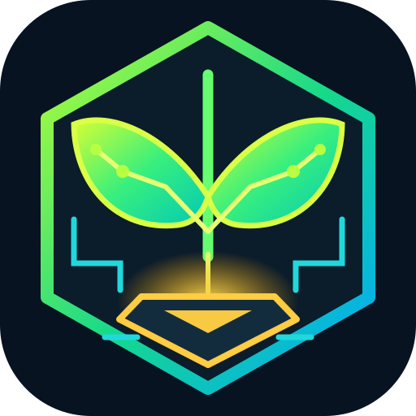

# SEED-X

**Self-Evolving Android AI Agent** — a local-first native Android AI workspace and Guardian-governed tool platform.

## Phase 1 — Native foundation
C++20 engine, Android NDK NativeActivity foundation, OpenGL ES 3 rendering surface, lifecycle kernel, event bus and host-side tests.

## Phase 2 — Guardian security & governance
- Independent default-deny policy engine with scoped tool/operation/resource rules.
- Explicit operator approval tickets, bound to one request, short-lived and one-use.
- Emergency stop and bounded hash-linked audit trail.
- Host tests for policy, approval, emergency-stop and audit behavior.

## Phase 3 — Local AI Brain
- Backend-neutral C++20 inference interface and model lifecycle manager.
- Optional real llama.cpp backend pinned to upstream b4514; GGUF loading and autoregressive token generation.
- Token callback streaming, cooperative cancellation, temperature/top-p sampling and context limits.
- Device memory probe, RAM admission and GGUF file validation.

## Phase 4 — Online AI Provider Layer
- Provider-neutral C++ contract for OpenAI-compatible, Anthropic and Gemini.
- DeepSeek, Qwen-compatible gateways and OpenRouter can use OpenAI-compatible chat-completions where supported.
- Credential references, HTTPS-by-default validation, request bounds and provider-reported usage.
- Local-first routing policy and explicit online fallback permission.
- Mock HTTP adapter tests. See docs/PHASE4.md.

## Phase 5 — Android AI Studio
- Native Android Java UI: Home, Chat, Voice, Memory, Models, Runtimes, Providers, Skills, Workflows, Tools, Guardian, Diagnostics and Settings.
- OpenAI-compatible, Anthropic and Gemini chat requests.
- Android Keystore AES-GCM credential encryption; online fallback OFF by default.
- GGUF document picker and app-private model storage.
- See docs/PHASE5.md.

## Phase 6 — JNI and live native integration
- Java UI loads the native C++ shared library and initializes AgentKernel.
- JNI connects GGUF model loading, local generation, token callbacks and cooperative cancellation to LocalAiRuntime.
- Local model is selected before cloud providers.
- Guardian screen reads live emergency-stop and audit-chain status; explicit operator confirmation controls stop/reset.
- See docs/PHASE6.md.

## Phase 7 — Guardian-Gated Tool Execution
- C++ typed tool registry with no shell or arbitrary command handler.
- Android Tools tab for device/runtime status and private-workspace listing/reading.
- New note creation is limited to the app-private workspace and requires a one-use, 60-second, request-bound Guardian approval.
- Guardian permission dashboard and recent audit-history viewer.
- Atomic authorization-and-execution boundary: emergency stop prevents new handlers and waits for an in-flight bounded handler to finish.
- Workspace path traversal protection, 1 MiB read cap, 64 KiB write cap, exclusive no-overwrite note creation.
- Host tests cover tool registration, approvals, replay rejection and emergency-stop blocking.
- See docs/PHASE7.md.

## Phase 8 — Universal AI Control Center (0.8.0)
- Dashboard, Chat, Voice, Memory, Models, Runtimes, Providers, Skills, Workflows, Tools, Guardian, Diagnostics and Settings screens.
- Multi-profile provider hub with presets for Gemini, Groq, OpenRouter, Cloudflare Workers AI, NVIDIA NIM, Z.AI, SambaNova, Cohere, Cerebras, OpenAI, Anthropic, DeepSeek, Mistral, Qwen, Together, Fireworks, Perplexity, xAI, Hugging Face Router, Ollama, LM Studio, llama.cpp server, LocalAI, vLLM and SGLang.
- Free-tier labels are qualified and limited; the app bundles no API keys and never promises unlimited free inference. Cloud prompts require explicit per-send confirmation.
- Local HTTP is opt-in and restricted in app code to loopback/private IPv4/.local endpoints. HTTPS remains required for public providers. Keyless local OpenAI-compatible servers are supported.
- Runtime catalogue covers llama.cpp, LiteRT-LM, MLC LLM, ExecuTorch, ONNX Runtime GenAI, MNN-LLM, ncnn, Ollama, LM Studio, LocalAI, vLLM, SGLang, OpenVINO and TensorRT-LLM. Only llama.cpp is currently embedded/integrated; other embedded runtimes need adapters.
- Twenty built-in prompt skills with search and enable/disable, six manual workflows, user-managed opt-in local memory, speech-to-text handoff and Android text-to-speech.
- Configurable system prompt, output tokens, temperature, top-p, context, provider timeout and response-size bounds.
- Device-aware model guide for constrained phones, imported GGUF model management, model deletion, runtime diagnostics and copyable privacy-safe diagnostics.
- Android launcher logo: assets/brand/seedx-logo.svg and android/app/src/main/res/drawable/seedx_logo.xml.
- Provider/runtime/skill/model catalogs are in config/ and bundled Android assets. See docs/PHASE8.md.

## Build on Windows PowerShell

Host tests:
    cmake -S . -B build
    cmake --build build --config Release
    ctest --test-dir build -C Release --output-on-failure

Android debug APK with JNI bridge and stub backend:
    gradle assembleDebug

Android debug APK with actual llama.cpp GGUF inference:
    gradle assembleDebug -PseedxLlamaCpp=ON

Install:
    adb install -r android/app/build/outputs/apk/debug/app-debug.apk

For a 6 GB RAM phone, start with small quantized GGUF models and a 2K context. The app estimates memory conservatively, but real device testing is still required.

## Security boundary
System 1 (Guardian) owns policy and authorization. System 2 model output is untrusted text. No model/provider output is executed as a shell command or tool action. Emergency-stop reset is operator-confirmed; model output cannot modify policies or reset Guardian.

## Current limitations
- The default APK uses the JNI stub backend. CI also attempts a second Android build with embedded llama.cpp and uploads it as `seedx-debug-apk-llama` if the NDK build succeeds. Locally enable it with `-PseedxLlamaCpp=ON`.
- The Android Java provider transport and C++ Phase 4 provider adapter remain separate implementations.
- Policy dashboard is read-only; a visual policy editor and third-party dynamic plugin loading are pending.
- Model-initiated autonomous tool planning is not enabled; operators launch tools from the Tool Center. No GPU/NPU acceleration or physical-device benchmark is claimed.
- SHA-256 model verification, signed model provenance and an in-app model downloader remain pending.

## License
MIT. See LICENSE.

## Phase 9 — Guardian-reviewed tool proposals

Phase 9 adds strict JSON proposal review in the Android Tool Center, mandatory operator confirmation, one-use Guardian approval for workspace writes, a bounded sandboxed workspace search tool, and Provider Hub presets loaded directly from the provider catalog. See [docs/PHASE9.md](docs/PHASE9.md) for implemented scope and explicit runtime/provider limitations.

## Phase 10 — Runtime Registry

Added a native runtime registry and live JNI availability reporting. Runtime Manager now marks a backend runnable only when a native factory is registered and compiled. LiteRT-LM, MLC LLM, ExecuTorch, ONNX Runtime GenAI and MNN-LLM remain explicitly unavailable until their SDK-backed adapters are implemented. See [docs/PHASE10.md](docs/PHASE10.md).

## Phase 11 — Model format contracts

Added explicit model package format identifiers and hardened runtime factory validation. A runtime cannot be instantiated unless its factory returns a backend compatible with its declared formats. GGUF remains the only currently validated local model format; ONNX, LiteRT, MLC, ExecuTorch, MNN and ncnn are recognized but not yet executable. See [docs/PHASE11.md](docs/PHASE11.md).

## Phase 12 — Android OS integration

Added a user-started Android foreground-session service, notification permission flow, Android app-permission settings shortcuts, and battery-optimization settings access. The service is a lifecycle foundation only: it does not execute tools or access privileged device APIs. It remains subject to Android background-start and foreground-service limits. See [docs/PHASE12.md](docs/PHASE12.md).

## Phase 14 — Crash and bug reporting

Added local fatal-crash capture, explicit non-fatal error recording, diagnostic preview/copy/delete controls, and a privacy-reviewed GitHub issue draft handoff. Reports are never uploaded automatically and exclude chat history, model files, provider credentials and API keys. See [docs/PHASE14.md](docs/PHASE14.md).

## Phase 15 — Diagnostics Center

Expanded Diagnostics with crash/error history, recent screen-navigation breadcrumbs, Guardian audit verification and reviewed GitHub issue drafts. Added a local breadcrumb privacy setting and bounded retention. No automatic telemetry or self-modifying repairs. See [docs/PHASE15.md](docs/PHASE15.md).

## Phase 16 — Error Intelligence & CI Evidence

Added heuristic error categories, normalized duplicate-crash fingerprints, a duplicate grouping view, complete local diagnostic clearing, and GitHub Actions core-job summaries. Native signal crash dumps and ANR capture remain explicitly unsupported. See [docs/PHASE16.md](docs/PHASE16.md).

## Phase 21 — AI Provider Expansion
Added bounded retry handling for transient provider/network failures, configurable retry limits, and privacy-safe local attempt/success/failure counters. Provider secrets remain in Android Keystore and remote fallback remains opt-in. See [docs/PHASE21.md](docs/PHASE21.md).

## Phase 22 — Android Operations UI
Added Permission Center, foreground-session Task Manager, curated GGUF Model Download Manager, high-contrast text and adjustable text sizing. The download flow uses app-specific storage and validates GGUF magic bytes before private-library import. Scheduled WorkManager queues, full theme switching and visual workflow editing are still pending. See [docs/PHASE22.md](docs/PHASE22.md).

## Phase 23 — Release Engineering
CI now validates JSON catalogs and the declared Android permission boundary, builds debug APK plus unsigned release APK/AAB artifacts, and uploads release artifacts. Added a security policy. Release signing and physical-device validation remain maintainer actions. See [docs/PHASE23.md](docs/PHASE23.md) and [SECURITY.md](SECURITY.md).

## Support development
SEED-X is free and open source. Optional donations help fund testing, model/runtime integration and maintenance. No subscription is required by this project.

- [GitHub Sponsors](https://github.com/sponsors/abdulraheemnohri)
